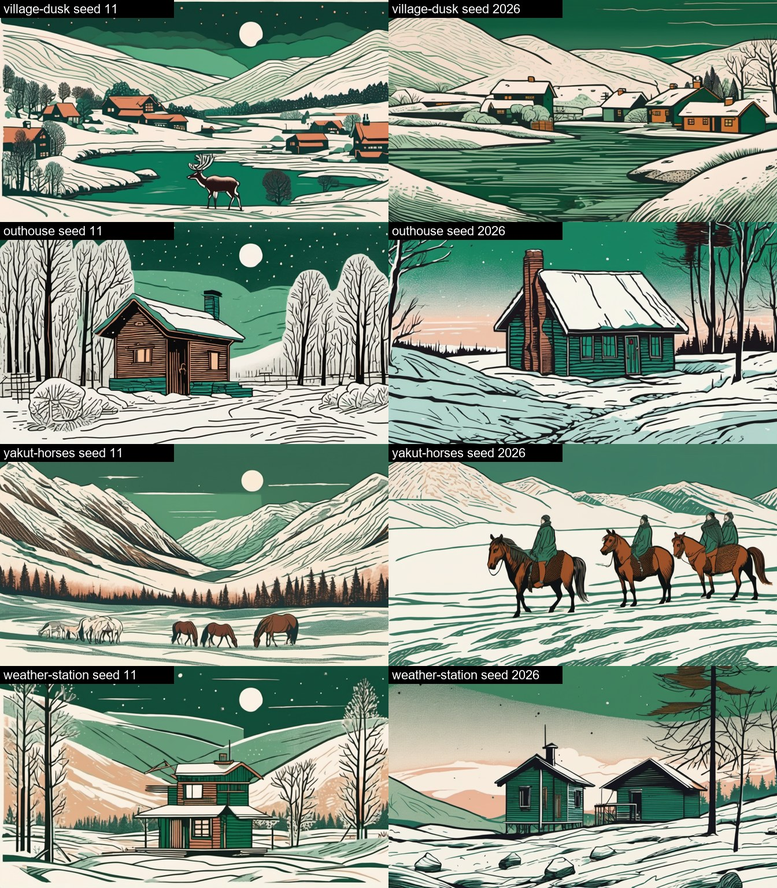
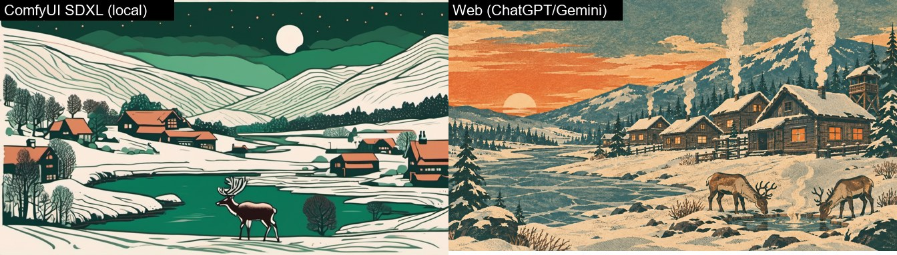

# Thử ComfyUI tạo ảnh nội bộ và chia hạng ảnh AI

> Ngày 17/11/2026. Người làm kênh xem video TikTok giới thiệu ComfyUI, bảo thử chất lượng, rồi chốt: ảnh quan trọng tạo bằng nguồn ngoài, ảnh phụ tạo nội bộ; đánh giá mức quan trọng ngay ở bước viết kịch bản.

## Kết luận

- **SDXL nội bộ vẽ phong cách risograph rất đúng bảng màu kênh, nhưng hay vẽ sai nội dung cụ thể.** Hợp cho ảnh phong cảnh, không khí, lớp xa. Không hợp cho ảnh phải có đúng đồ vật, con vật, hành động của nơi đó.
- Khoảng **40–55 giây/ảnh** 1344×768 trên RTX 3050 Laptop 4 GB VRAM, 14 GB RAM. Ảnh đầu 108 giây vì nạp model. Miễn phí, không watermark, không giới hạn lượt.
- Vì vậy mỗi ảnh AI được chấm 4 tiêu chí ngay trong `script.json` → `anh_ai`: ảnh **chính** đi nguồn ngoài, ảnh **phụ** tạo nội bộ. Luật: [.claude/skills/viet-kich-ban/references/hang-anh.md](../.claude/skills/viet-kich-ban/references/hang-anh.md).

## Thử nghiệm

4 cảnh Oymyakon × 2 seed, dùng prompt rút từ `projects/2026-11-16-oymyakon/assets/ai/*.prompt.txt` cùng phong cách `templates/_shared/phong-cach-anh.txt`. SDXL base 1.0, 25 bước, cfg 6,5, dpmpp_2m karras, 1344×768.

| Cảnh | Prompt yêu cầu | SDXL ra |
|---|---|---|
| village-dusk | Làng gỗ chạng vạng, khói thẳng, sông đóng băng, tuần lộc uống ở suối bốc hơi | Làng đẹp nhưng nhà kiểu châu Âu, không khói, sông không đóng băng; một bản có hươu đỏ, một bản không có con vật nào |
| outhouse | Nhà xí gỗ ngoài sân tuyết | Cả hai bản ra nhà gỗ có ống khói |
| yakut-horses | Ngựa Yakut lông xù dày | Ngựa thường lông mượt; một bản tự thêm người cưỡi |
| weather-station | Lều gỗ, lều đặt máy đo trên chân, chong chóng gió | Nhà gỗ thường, không có máy đo |
| Chung | Chừa trống 1/3 trái | Không theo; bản nào cũng tự thêm mặt trăng |

Ảnh web cũ (`ai-village-dusk`, ChatGPT) đúng đủ chi tiết nhưng lệch màu (trời cam, nước xanh dương).

## Cài đặt trên máy này

| Mục | Giá trị |
|---|---|
| Thư mục | `D:/ComfyUI` (không đặt trong OneDrive; ổ C gần đầy) |
| Mã | `git clone --depth 1 https://github.com/Comfy-Org/ComfyUI.git` (GPL-3.0; bản v0.45.0 ngày 10/11/2026) |
| Python | venv riêng `D:/ComfyUI/.venv`, Python 3.13 |
| PyTorch | `pip install torch torchvision torchaudio --index-url https://download.pytorch.org/whl/cu130`. Dùng `--index-url`, **không** `--extra-index-url`: lần đầu pip lấy nhầm bản CPU 2.15.0 từ PyPI vì số bản cao hơn bản CUDA 2.14.1 |
| Model | `models/checkpoints/sd_xl_base_1.0.safetensors` (6,9 GB) từ https://huggingface.co/stabilityai/stable-diffusion-xl-base-1.0, giấy phép CreativeML Open RAIL++-M (cho dùng thương mại đầu ra, kèm các giới hạn sử dụng) |
| Chạy | `tao_anh_noi_bo.py` tự bật với `--offline` (không tải gì, tắt các node API trả phí) và tắt bằng lệnh `tat` |
| Dung lượng | Khoảng 12 GB trên ổ D; bộ nhớ đệm pip đã xoá |

## Còn mở

- Model hiểu prompt tốt hơn để nâng chất lượng ảnh phụ: **Z-Image Turbo**, **Flux.1 schnell** (Apache-2.0). Chưa thử, cần đọc giấy phép gốc rồi mới thêm vào `MODELS`. Với 4 GB VRAM có thể chậm hơn SDXL nhiều.
- Ảnh ngoài và ảnh nội bộ lệch màu nhau: chưa có bước đồng màu tự động; hiện xem bằng mắt các cảnh liền nhau.
- Ảnh SDXL ra 1344×768, phóng lên 1920×1080 bằng Lanczos, hơi mềm. Có thể thêm bước phóng bằng model nếu thấy cần.
